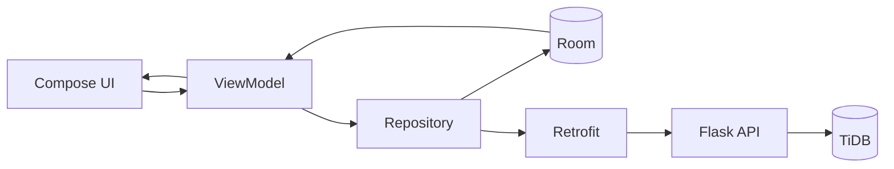

<p align="center">
  
</p>

# RoutineTrack

RoutineTrack is an Android app for creating habits, recording progress and checking statistics. It works locally with Room and can synchronize data through a Flask backend.

[](https://github.com/zRoby03/RoutineTrack/actions/workflows/ci.yml)
[](https://developer.android.com/)
[](https://kotlinlang.org/)

## Main features

- Boolean and numeric habits with custom frequency and targets.
- Daily progress, streaks, calendar and statistics.
- Local storage with Room and reactive state with Flow.
- Reminders through Android notifications.
- Manual synchronization with a TiDB/MySQL database.
- Light and dark themes.

## Stack

- Kotlin, Jetpack Compose and Material 3.
- ViewModel, coroutines, Flow and StateFlow.
- Room, Retrofit, Moshi and OkHttp.
- Python, Flask, Gunicorn and PyMySQL.

## Architecture



The project follows an MVVM structure. Room is the local source of data; the backend receives pending changes and returns the synchronized state.

## Requirements

- Android Studio, Android SDK 36 and JDK 17.
- Python 3.11 or newer.
- A TiDB or MySQL-compatible database.

## Backend setup

```bash
cd backend_tidb
python -m venv .venv
pip install -r requirements.txt
```

Copy `.env.example` to `.env`, fill in the database settings and generate `APP_SECRET_KEY`:

```bash
python -c "import secrets; print(secrets.token_urlsafe(48))"
```

Then start the API:

```bash
python app.py
```

The default port is `5000`. The root `render.yaml` can be used to deploy the backend on Render.

## Android setup

Pass the HTTPS API URL as a Gradle property:

```bash
./gradlew :app:assembleDebug -PROUTINETRACK_API_BASE_URL=https://api.example.com/
```

On Windows use `gradlew.bat`. You can also save the property in your user-level Gradle configuration, outside this repository.

## Checks

```bash
pip install -r backend_tidb/requirements-dev.txt
pytest -q
python -m compileall -q backend_tidb app.py
./gradlew :app:assembleDebug
```

The same checks run on GitHub Actions.

## Notes

- Synchronization is currently manual.
- Conflicts use a timestamp-based last-write-wins rule.
- WorkManager integration exists but is not scheduled automatically.
- Room still needs explicit migrations before a production release.
- Security problems should be reported as described in [SECURITY.md](SECURITY.md).

## License

No open-source license has been selected yet.
